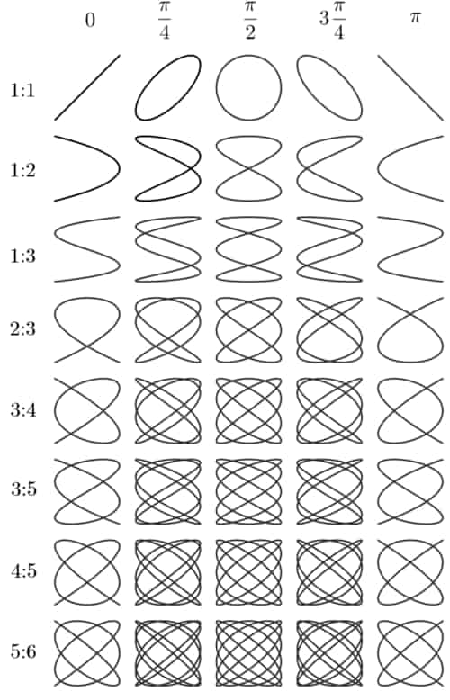
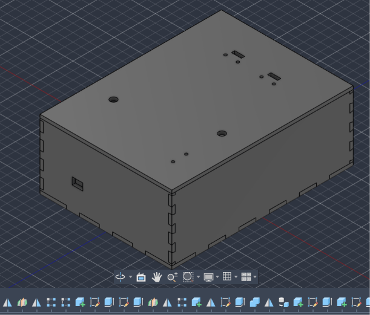
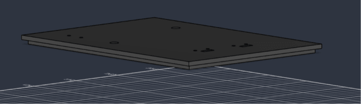

## Introduction

The idea behind my final project was to create an artistic, interactive piece that actively involves the viewer as part of the experience.

The main idea revolves around **Lissajous Curve**

### What are Lissajous Curves?

A Lissajous curve, also known as a Lissajous figure or Bowditch curve, is the graph of a system of parametric equations:

$$
x = A\sin(at + \delta), \quad y = B\sin(bt)
$$

These equations describe the superposition of two perpendicular oscillations in the $x$ and $y$ directions with different angular frequencies ($a$ and $b$).

The resulting family of curves was investigated by Nathaniel Bowditch in 1815, and later in more detail in 1857 by Jules Antoine Lissajous (after whom it was named). Such motions may be considered a particular kind of complex harmonic motion.

The appearance of the figure is highly sensitive to the ratio $\frac{a}{b}$:

* **Ratio of 1 ($a = b$):** The figure is an ellipse, with special cases including circles ($A = B, \delta = \frac{\pi}{2}$) and straight lines (when the phase shift is any multiple of $\pi$ radians: $\delta = n\pi, n \in \mathbb{N}$).
* **Slight frequency change:** The $x$ oscillation after one cycle will be slightly out of synchronization with the $y$ motion. As a result, the ellipse fails to close and traces a slightly adjacent curve during the next orbit, appearing as a precession of the ellipse.
* **Rational ratio ($\frac{a}{b}$ is a whole number ratio):** The pattern closes completely.

*(Sources: [Wikipedia – Lissajous Curve](https://en.wikipedia.org/wiki/Lissajous_curve), [Springer – Foundations of Science](https://link.springer.com/article/10.1007/s10699-023-09930-z))*

<figure markdown="span">
  { width="500" }
  <figcaption>Lissajous curves in relation to the frequency ratio a/b and phase shift δ.</figcaption>
</figure>

### Artistic Inspiration

Lissajous curves are widely used in graphic design, kinetic art installations, and even in cinematography. A famous example is the iconic title sequence of Alfred Hitchcock's movie **[Vertigo (1958)](https://www.youtube.com/watch?v=SkLn8mamU78)**, designed by Saul Bass and John Whitney, where parametric curves were used to create hypnotic visual effects.

## My Project

For my final project, I aim to visualize **Lissajous curves** using the classic optical experiment of a laser beam reflecting off two spinning mirrors. To make the installation interactive, the system incorporates motion sensors that detect the observer's presence or movement, dynamically altering the rotational speed of the mirrors and transforming the projected patterns in real time.

### How It Works

The optical and mechanical setup operates as follows:

1. **Beam Reflection:** A laser beam is directed onto a primary spinning mirror, which then reflects the beam onto a second spinning mirror positioned across from it.
2. **Projection:** The combined angular velocities of the two slightly tilted mirrors deflect the laser beam along both the $x$ and $y$ axes, projecting complex Lissajous figures onto an adjacent wall.
3. **Interactive Control:** Motion sensors mounted along the edge of the base detect the viewer's proximity and movement, feeding data to the microcontroller to modulate the speed of the motors—continuously shifting the frequency ratio and morphing the curve.

### Physical Enclosure

The entire optical assembly will be mounted on top of a custom-designed enclosure (box):

* **Top Surface:** Houses the laser module and the two motor-driven mirror mounts.
* **Outer Edge:** Integrates the motion sensors facing the viewer.
* **Interior:** Conceals and protects the custom PCB, motor drivers, wiring, and battery pack.

The 3D designs of the costum-designed enclosure can be shown below: 

  
  

