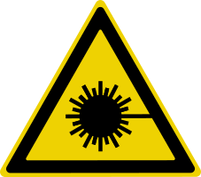
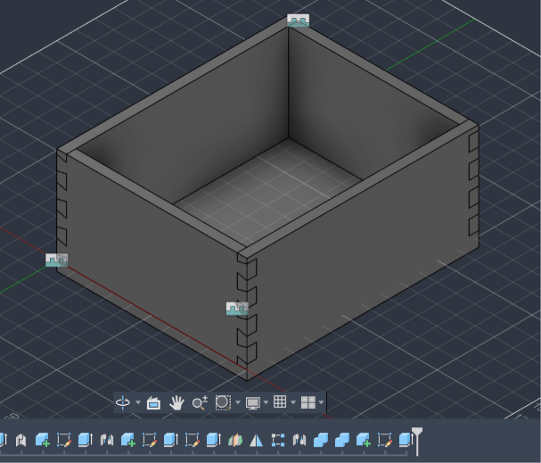
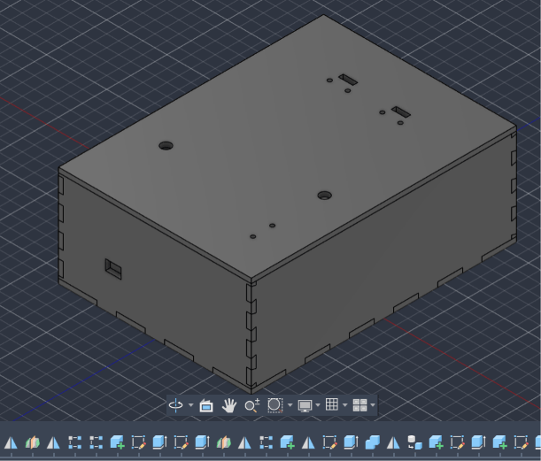
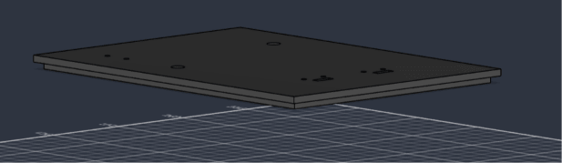

# Computer Aided Design

Second week was an indroduction to Computer Aided Design and dedigning in 2D and 3D. It was a topic completely new for me but found really interesting to be able to visualize in a computer objects that suround us.

## Inkscape

For 2D design I experimented with Inkscape. After easily downloading it from Microsoft Store, I started following a few tutorials on Youtube to get an idea. 
(Youtube Links: [Inkscape Tutorial](https://www.youtube.com/watch?v=fzk-suGcqrc&t=2732s))
After trying on the designs on the video, I designed something that could be used on my project.
Since I will be using laser, even tho it's the most common laser yoy can find, I thought of making a Warning Laser sign that you can see on the picture.

For Vinyl Cutting there is an extension called InkCut

{ width="200" }

### Tips for Inkscape
* Parallelogram + Ctrl -> Square
* Parallelogram + Ctrl + Shift -> Centered Parallelogram 
* Shift + center of the box -> Center back in the middle
* Spacebar + object -> copies of object

### Notes on the Logo
* When trying to center to triangles together, Inkscape will center them based on the center of the box surrounding them and not the actual center. To center all 3 of the triangles I used, I created the first one and then I made the other 2 using offset.After thta you have to click on Path-> Object to Path for the 2 triangles and you can use them normally.
* To make them have rounded edges you need to go to Path-> Path Effects-> Corners

## Fushion 360

For 3D design I decided to use Fushion 360. Since I already had a student account on Autocad from my home university it was only easy to download Fusion 360.
I was happily surprised that Fusion was really use to use and had a lot of different tools that make your life easy.
To start getting a grasp of it I followed playlist tutorial on Youtube that was guiding you through in detail in designing many basic objects usuing all the tools.
The link for the playlist is the following: [Fushion 360 Beginner Tutorial](https://www.youtube.com/playlist?list=PLrZ2zKOtC_-C4rWfapgngoe9o2-ng8ZBr). I followed along till Day 15. Tip: Try to make the objects on your own cause it turns out it's easy to forget :)

  
  
  
  

### Tips on Fushion
* Carefully to the construction lines 
* History bar is really important

## Final Project: 2D & 3D

For my final project I wanted to make a box. The box will be used to store inside the power supplies(batteries), the motors and the PCB. On the top side of the box there will be the laser, the mirrors and the motion sensors.

To start bulding the box I experimented on some designs from Youtube to learn how to make dovetail joints ([Dovetail Joints](https://www.youtube.com/watch?v=RB2TqZ6bP_E))
{ width="500" }

Then combining the dovetail joints with the Finger Joint Box tutorial ([Finger Joints](https://www.youtube.com/watch?v=ZrcqauNvt0M&t=622s)), I created a box that has dovetail joints on the side panels for the best stability and finger joints to connect the bottom side. The Top Panel also has an inner rim to connect seamlesssly with the rest of the body.

  
  

